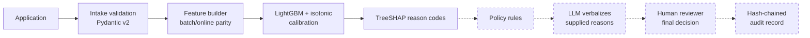

# Loan Review Assistant

A human-led consumer loan review assistant built on the public
[Home Credit Default Risk](https://www.kaggle.com/c/home-credit-default-risk) dataset.
It scores an application with a calibrated LightGBM model, explains the score with
SHAP-based reason codes, and is designed so that **a human reviewer makes every
final credit decision**. The LLM layer (planned) will only verbalize reasons that
the model and policy rules supply. It never chooses reasons or decisions.

> Built from scratch on public data. Contains no client code or client data.

## Status

| Stage | Status |
|---|---|
| Data pipeline: stratified splits, history aggregation, proxy-discrimination screen | ✅ Implemented |
| Risk model: LightGBM + Optuna tuning + isotonic calibration, versioned artifacts | ✅ Implemented |
| Explanations: TreeSHAP + fixed reason-code dictionary | ✅ Implemented |
| Intake: Pydantic v2 validation of a single application, batch/online feature parity | ✅ Implemented |
| Policy rules, LangGraph orchestration, Bedrock LLM verbalization | 🚧 Planned (modules scaffolded) |
| Human-review routing, hash-chained audit store, fairness audit, FastAPI, evals | 🚧 Planned (modules scaffolded) |

Tests: 32 offline tests (synthetic data, deterministic `FakeLLM`, no network calls),
plus lint and type checks, run in CI on every push.

## Architecture



Solid boxes are implemented; dashed boxes are planned.

## Design rules

These apply to the implemented stages now and are the contract for the planned ones:

- The LLM never makes or recommends the final credit decision. A human reviewer does.
- The LLM never chooses reasons. Reasons come from SHAP, a fixed reason-code
  dictionary, and failed policy rules.
- Protected attributes (`CODE_GENDER`, `DAYS_BIRTH`, `NAME_FAMILY_STATUS`) are never
  model features. They are used only for the proxy screen and fairness audit.
- All tool and LLM I/O is validated with Pydantic v2. On validation failure: retry
  once, then route to human review with an error flag (planned for LLM stages).
- Every config and artifact is versioned and fingerprinted.

## Quickstart

Install [uv](https://docs.astral.sh/uv/), then:

```sh
uv python install
uv sync --locked
make lint type test
```

Python is pinned to 3.11, and `uv.lock` fixes dependency versions.

## 1. Prepare data

Place `application_train.csv`, `bureau.csv`, and `previous_application.csv` from
Home Credit Default Risk in `data/raw/`, then run:

```sh
uv run --locked python -m loan_review.data --seed 42
```

This writes a versioned directory, `artifacts/data-v1.0.0-<content-hash>/`, with:

- `train/val/test_features.parquet`: model columns only (no IDs, target, or
  protected attributes), plus aligned `*_labels.parquet` files.
- `*_audit_attributes.parquet`: protected attributes, kept separate from features.
- `feature_manifest.yaml`: exact feature names, sources, dtypes, and descriptions.
- `proxy_report.csv`: training-only association statistics between features and
  protected attributes.
- `metadata.json`: seed, settings, split sizes, library versions, and SHA-256
  hashes of inputs, code, and outputs.

Applications are stratified on `TARGET` into 70/15/15 splits **before** history
aggregation, and each history table is restricted to that split's applicants, so
no information leaks across splits.

**Proxy screen.** On a seeded sample of up to 20,000 training applicants, features
are flagged if their absolute Pearson correlation with a protected attribute
exceeds 0.3 or their mutual information exceeds 0.1 nats. These heuristics surface
candidates for review; they do not establish fairness or remove features automatically.

## 2. Train, calibrate, and evaluate

```sh
uv run --locked python -m loan_review.model \
  --data-dir artifacts/data-v1.0.0-<content-hash> --trials 10 --seed 42
```

- Optuna runs sequential trials (default 10, max 30) over learning rate, leaf count,
  minimum leaf size, and L2 regularization, selecting by validation AUC with early stopping.
- The selected model is calibrated with isotonic regression on validation predictions.
- The test split is loaded only after the model and calibrator are saved, and
  test metrics never feed back into tuning, calibration, or thresholds.

Outputs:

- `artifacts/models/<model_version>/`: native LightGBM model, portable isotonic
  calibrator (JSON, no pickle), encoder, config snapshots, and provenance metadata.
  The model version is a SHA-256 fingerprint of data, parameters, code, and libraries.
- `artifacts/model_report/<model_version>/<test-data-hash>/`: `metrics.json` (raw
  and calibrated AUC, KS, Brier), `reliability.png`, and `reliability_bins.csv`.

### Results

Metrics come from `metrics.json` on the held-out test split (stratified random
holdout, see Limitations). Fill in this table from your own run:

| Metric (test split) | Raw | Calibrated |
|---|---|---|
| ROC-AUC | | |
| KS | | |
| Brier score | | |

## 3. Reviewer bands and explanations

`configs/thresholds.yaml` defines illustrative bands on calibrated default
probability: **LOW** < 0.05, **MEDIUM** 0.05–0.15, **HIGH** ≥ 0.15. These are inputs
for a human reviewer, not credit decisions or validated operational cutoffs.

`configs/reason_codes.yaml` maps all 175 unprotected model features to fixed reason
codes. Training and explanation fail if any model feature lacks a mapping.

```python
from pathlib import Path
import polars as pl

from loan_review.model.bundle import load_model
from loan_review.model.explanations import explain_applications
from loan_review.model.reasons import top_reasons

model = load_model(Path("artifacts/models/<model_version>"))
features = pl.read_parquet("artifacts/data-v1.0.0-<content-hash>/test_features.parquet")
scores = model.score(features)  # probabilities and reviewer bands; no decisions
explanation = explain_applications(model, features.head(1))[0]
reasons = top_reasons(explanation.shap_row, k=4, reason_codes=model.reason_codes)
```

TreeSHAP contributions (raw log-odds output) are checked to sum with the baseline to
the model's raw score. `top_reasons` groups signed SHAP values by reason code, keeps
groups that push toward default, and returns up to four deduplicated reasons with
supporting features and offsets.

## 4. Validate one application at intake

`loan_review.graph.intake_node` validates a single raw application with Pydantic v2
and returns `IntakeResult(valid, errors, normalized)`. Errors name the failing fields
without echoing submitted values. `TARGET` is never accepted from a live application,
unknown columns fail validation, and the free-text `employer_name` field is treated as
untrusted: it is excluded from model features and from any prompt.

`build_application_features` reuses the exact batch aggregation logic and checks the
saved manifest's column order and dtypes, so a single online application produces the
same features as the training pipeline.

## Limitations

- **No out-of-time validation.** Home Credit has no absolute application dates, so
  splits are stratified random holdouts. They cannot measure population or economic drift.
- The validation split is reused for early stopping, model selection, and calibration,
  which can overfit that holdout.
- SHAP explanations are associative, not causal, and correlated features can trade
  attributions. They decompose the raw log-odds, not the calibrated probability.
- Risk bands are illustrative, not validated lending cutoffs.

## Layout

```
src/loan_review/
  data/      # split, aggregate, proxy screen            (implemented)
  model/     # train, calibrate, explain, version        (implemented)
  graph/     # intake implemented; workflow planned
  policy/    # policy rules                              (planned)
  llm/       # Bedrock adapter + FakeLLM for tests       (FakeLLM implemented)
  audit/     # hash-chained audit store                  (planned)
  fairness/  # fairness audit                            (planned)
  evals/     # explanation and safeguard evals           (planned)
  api/       # FastAPI review endpoints                  (planned)
configs/     # feature manifest, reason codes, thresholds
tests/       # offline tests on synthetic data
```
